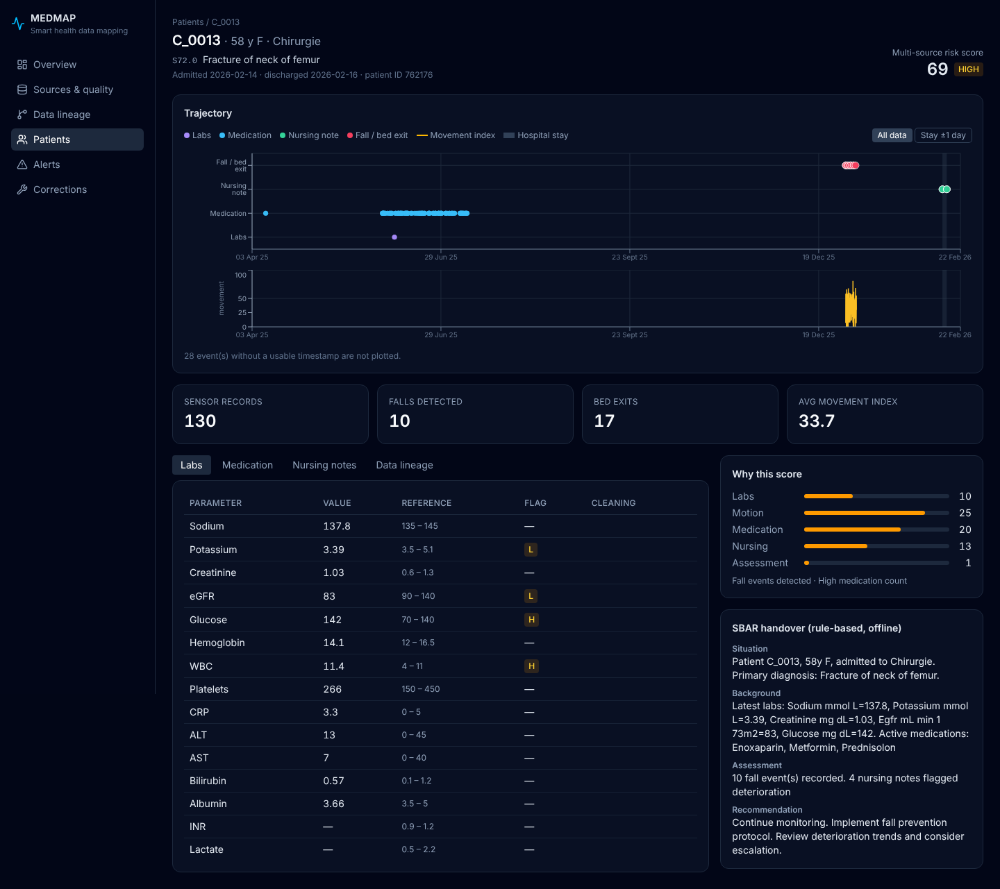
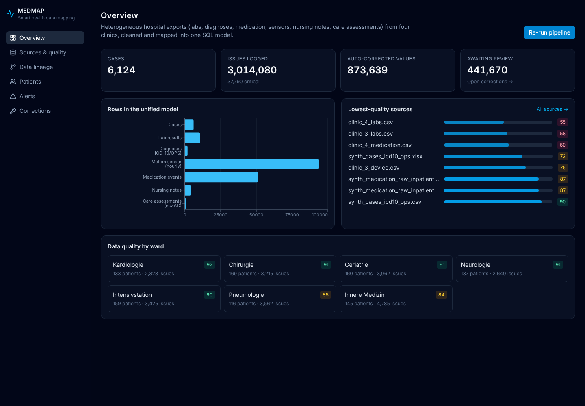
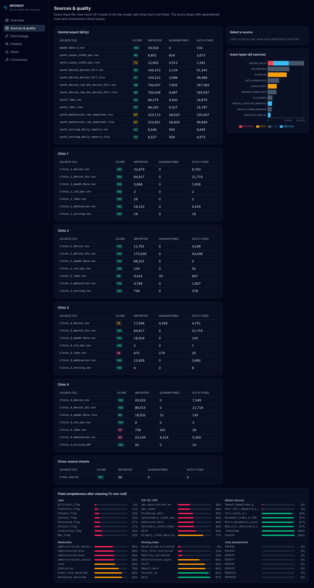

# MEDMAP: Smart Health Data Mapping

MEDMAP takes messy clinical exports from several hospitals and turns them into one clean, traceable database. It ingests labs, diagnoses, medication records, wearable motion sensors, free-text nursing notes and care assessments, repairs what it can, flags what it can't, and records where every value came from.

The project started at **START Hack 2026** (St. Gallen, March 2026) on the challenge set by [epaCC / epaSOLUTIONS](https://www.epa-cc.de/), *"Smart Health Data Mapping: From Raw Data to Insights"*.



## The problem

Hospitals keep data in many systems that don't talk to each other: the hospital information system, lab software, Excel exports, bedside sensors and nursing notes. Each one uses its own format, IDs, date conventions and language (German and English, sometimes SAP codes). Merging them for analytics is mostly manual work today.

The challenge asked for a system that:

1. ingests structured tables, Excel files, PDFs and free text,
2. maps every field to a unified target model (the SQL schema epaCC provided),
3. handles missing values, encoding problems, inconsistent IDs and semantic variations on its own,
4. shows data origin, quality, anomalies and alerts in a dashboard,
5. lets a human review and correct flagged values, with an audit trail,
6. runs **on-premises**, because clinical data must stay in the hospital.

The dataset contains about 590,000 rows across 41 files. It includes a "dirty" central export and four clinics that each ship the same seven data types in their own layout (CSV, XLSX and one PDF), with errors injected on purpose.

## What it does

**Pipeline** (`medmap/pipeline/`, 8 steps):

| Step | What happens |
|---|---|
| Ingestion | Detects each file's type from its columns, not its name. Reads CSV (encoding sniffed), XLSX and PDF (`pdfplumber`). |
| Schema detection | Maps raw headers (German, English, SAP codes such as `EPA0001`, decoded via `IID-SID-ITEM.csv`) to target columns, with a confidence score for each mapping. |
| Validation | Runs type, range and referential checks against clinical reference ranges. |
| Cleaning | Normalizes missing-value tokens, dates, gender, IDs, lab flags, shift names and ward names. Removes duplicates and strips injected noise characters. Prefixes patient IDs by source so the same ID from two systems can't silently merge. |
| NLP | Extracts pain level, mobility, wound status and deterioration signs from English and German nursing notes. |
| Mapping | Links rows to cases (using patient ID + timestamp when a file has no case ID) and writes the 7 target tables. |
| Export | Writes to SQLite by default. SQL Server is supported through `pyodbc`. |
| Anomaly detection | Runs 6 cross-source rules, for example a fall on the motion sensor together with deterioration in nursing notes, or a nephrotoxic drug while kidney function is dropping. |

Every change is logged twice: in `tbAuditLog` (old value, new value, rule, severity, action) and in a per-field **data passport** (`tbDataPassport`) that traces the value back to its source file and row.

**API** (`medmap/api/`): FastAPI, about 45 endpoints, with docs at `http://localhost:8000/docs`.

**Dashboard** (`frontend/`): Next.js + Recharts, connected to the API.

| Page | Purpose |
|---|---|
| Overview | Row counts in the unified model, lowest-quality sources, quality by ward, and a button to re-run the pipeline. |
| Sources & quality | Every input file with its score, imported, quarantined and auto-fixed rows, issue types, and field completeness after cleaning. |
| Data lineage | The audit log, filterable by file and severity: original value → cleaned value, and why. |
| Patients | A per-case **trajectory**: labs, medication, nursing notes, falls and movement on one time axis, plus labs, notes, a risk score, an SBAR handover and the case's lineage. |
| Alerts | Cross-source alerts, filterable by rule. Alerts can be marked as treated. |
| Corrections | A review queue for critical issues. Save a value or roll it back. Every action is written to the audit log. |

| | |
|---|---|
|  |  |

## Running it locally

Requirements: Python 3.11–3.13 and Node 20+. The dataset (`medmap/data/`) is not in the repository. Copy the challenge data into `medmap/data/{clean,dirty,split}` along with `IID-SID-ITEM.csv`, and put `CreateImportTables.sql` in `medmap/data/db/`.

```bash
# 1. Backend
cd medmap
python -m venv .venv && source .venv/bin/activate
pip install -r requirements.txt
cp .env.example .env            # optional: ANTHROPIC_API_KEY for the LLM features
uvicorn api.main:app --port 8000

# 2. Build the database (about 3 minutes); you can also use "Re-run pipeline" in the UI
curl -X POST localhost:8000/api/pipeline/start -H 'Content-Type: application/json' -d '{"data_folder":"dirty"}'

# 3. Frontend
cd ../frontend
npm install
cp .env.example .env.local
npm run dev                     # http://localhost:3000
```

Or start everything with Docker: `docker compose up --build`.

Tests: `cd medmap && python -m pytest tests` (1,546 tests).

### Offline by default

Everything except three optional features runs without network access. "Ask your data", LLM-written SBAR summaries and auto-generated documentation call the Anthropic API only if `ANTHROPIC_API_KEY` is set. Without it they fall back to rule-based logic. The SBAR shown in the dashboard is the rule-based version.

## Known limitations

- The synthetic sources were generated independently, so timestamps don't always agree across them. For example, a patient's medication records can predate their admission by months. The trajectory view plots everything as-is and offers a "stay ±1 day" filter instead of hiding the mismatch.
- About 6,100 cases end up in `tbCaseData`, more than the roughly 1,000 real patients. IDs that can't be safely matched across sources are kept apart on purpose (source prefixes) rather than merged on a guess.
- The source quality score is coarse: many clinic files score 100 even though values were auto-corrected.

## Repository history

- **March 19–20, 2026 (START Hack):** pipeline, API, agents and tests, by Ayoub Ouederni (see `git log`).
- **November 2026:** fixes and the connected dashboard (commits by Saad Amraoui):
  - pinned `pandas<3`, because pandas 3 crashed the mapping step (`LossySetitemError` in `_resolve_case_ids`),
  - route-registration test updated for current FastAPI,
  - ward names normalized (noise characters such as `Chirurgie@` or `Kardiologieü`, and ICD codes that ended up in the ward column),
  - SBAR lab labels no longer mangled ("Glucose" was rendered as "Gluse"),
  - patient timeline returns sensor and medication events in chronological order,
  - new `frontend/` connected to the API, plus Docker setup for it.
